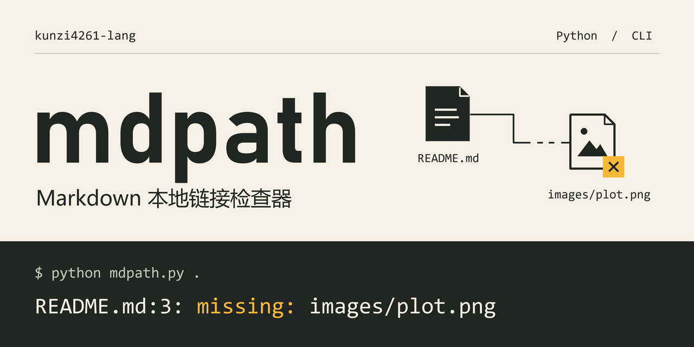

# 你好，我是 kunzi4261-lang

## 深蓝回声 · HADAL SURVEY

第一趟下潜，驾驶舱里只有母站的位置。发一束声呐，等前方浮出回波，再决定把探测器开向哪里。三片海域里藏着九份记录，串起了一组失落声信标的去向。

[](https://kunzi4261-lang.github.io/hadal-survey/)

海床的同一个高度函数同时决定镜头前的地形、驾驶舱的深度读数和报告里的等深线。关掉 WebGL 也可以继续驾驶，返航后还能拖动时间轴复看自己的路线。[开始下潜](https://kunzi4261-lang.github.io/hadal-survey/) · [看渲染器](https://github.com/kunzi4261-lang/hadal-survey/tree/main/src/render) · [看航行模拟与测试](https://github.com/kunzi4261-lang/hadal-survey/tree/main/tests)

## 口袋实验室 · Pocket Lab

给港口起个名字，看看它入夜的样子；再给这幅画编一小节鼓点。两个浏览器实验都能分享，也能把自己做的图和声音导出来。

[](https://kunzi4261-lang.github.io/pocket-lab/)

[画一座像素港湾](https://kunzi4261-lang.github.io/pocket-lab/city/) · [编一段鼓点](https://kunzi4261-lang.github.io/pocket-lab/beat/) · [看实现](https://github.com/kunzi4261-lang/pocket-lab)

## mdpath · Markdown 链接检查器

仓库里的一张截图改了名，哪几篇文档要跟着改？我做了 **mdpath** 来回答这个问题。它用 Python 标准库检查 Markdown 里的本地链接，把失效引用定位到具体的一行。

[](https://github.com/kunzi4261-lang/mdpath)

### 一行 Markdown，要检查几张图？

假设 `notes.md` 的第一行这样写，两张图都没有放进仓库。

```markdown
语法示例：``。实验结果：。
```

反引号里的写法会原样显示，只有实验曲线需要加载图片。运行 mdpath，诊断指向这一处。

```text
notes.md:1: missing: result.png
```

解析器还要处理成组的反引号和路径里嵌套的括号。我把这些容易漏掉的写法都放进了测试。[读解析器](https://github.com/kunzi4261-lang/mdpath/blob/main/mdlinks.py) · [看边界用例](https://github.com/kunzi4261-lang/mdpath/blob/main/tests/test_mdlinks.py) · [看跨平台测试记录](https://github.com/kunzi4261-lang/mdpath/actions/workflows/check.yml)
